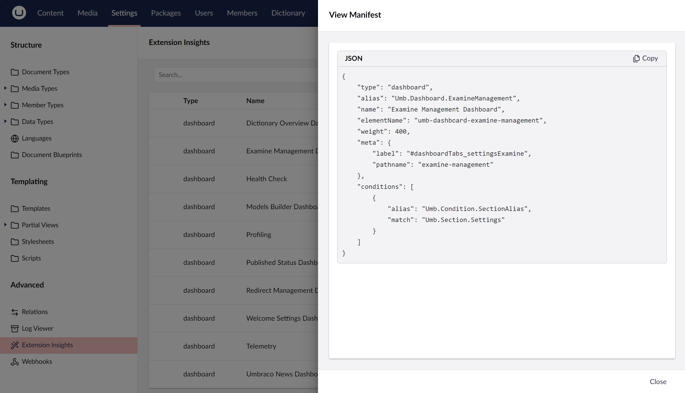

# Manifest Peek
This is a small utility package for Umbraco V17+ (see [version compatibility](#version-compatibility)) that allows you to view the backoffice manifests JSON.

Trying to understand how Umbraco backoffice extensions and other packages you install and what the shape of the JSON should be for the manifest and this is a tool in our toolkits to help with debugging and understandhing how extensions are registering and hopefully should save some source code diving into the Umbraco source code.

## Version compatibility
The package major version matches the Umbraco major version it supports.

| Package version | Umbraco version |
|-----------------|-----------------|
| 19.x            | 19              |
| 18.x            | 18              |
| 17.x            | 17              |

Install the NuGet package version matching your Umbraco major version.

---

_Lovingly crafted for you by [Warren Buckley](https://github.com/sponsors/warrenbuckley)❤️_

_[Available for hire](https://hackmakedo.com/)_
